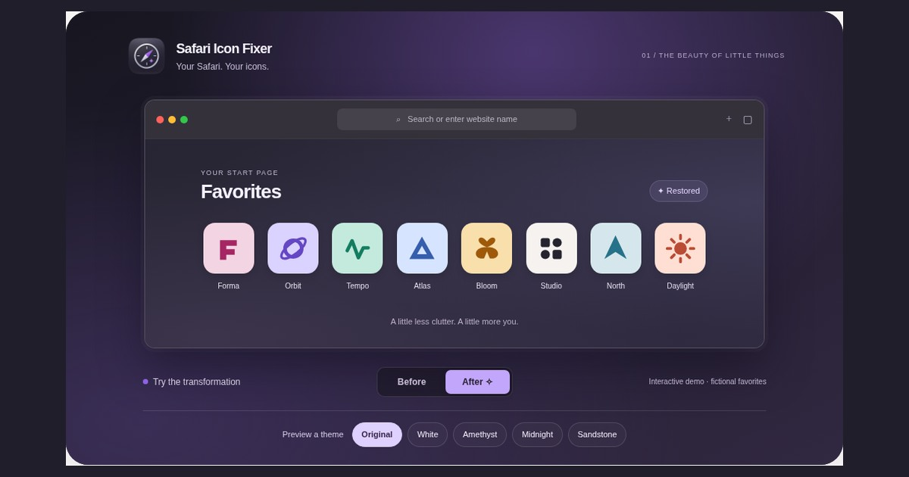

  

# Safari Icon Fixer

**Your Safari. Your icons.**

Repair missing Favorites icons, customize your start page, and make Safari feel like yours again.

[Product website](https://suberb.github.io/safari-icon-fixer/) · [Latest release](https://github.com/suberb/safari-icon-fixer/releases/latest) · [All releases](https://github.com/suberb/safari-icon-fixer/releases) · [Changelog](CHANGELOG.md)

macOS · Apple Silicon · Free · No account required

## Give your Favorites a fresh look

- **Repair** missing icons or force-refresh the cached ones Safari isn't showing.
- **Personalize** with images from the web, custom backgrounds, logo margins, or colors taken from an icon.
- **Color Studio+**: contrast-aware Smart Color, seven presets, visible-icon or selection styling, and portable local icon collections.
- **Organize** with a visual library, smart filters and batch color presets (Command/Shift selection).
- **Preview** a simulated Safari start page before applying. Drag supported graphics onto icons.
- **Navigate** with arrow keys in the library, Quick Look (⌘Y or Space with library focus on macOS 14+), compare (⇧⌘Y), search (⌘F) and rescan (⌘R).
- **Undo** automatically staged appearance edits, recover compatible drafts, and restore earlier graphics. Browse local backups by date and size.
- **Protect** applied custom icons in a local collection and prepare restoration if a new scan detects a difference in Safari’s cache.
- **Stay current** with signed Sparkle updates, checked on launch, with optional automatic installation.

## Six languages. One app.

English · Deutsch · Français · Українська · Polski · Español

Automatically follows your preferred supported system language, or choose your own in the app's Language menu (applies after reopening).

## Try before granting access

Choose **Try demo** on the welcome screen (v0.7.0+) or in the sidebar. Explore eight fictional Favorites, Quick Repair, Color Studio and simulated Apply; changes are temporary and the standalone demo does not read or write Safari.

## Get started

1. Download the latest **DMG** and drag Safari Icon Fixer into Applications.
2. Open the app. If required, grant Full Disk Access in System Settings → Privacy & Security.
3. Scan Favorites, choose your icons, quit Safari, and apply your changes. Reopen Safari to see the result.

**First launch:** the current app is ad hoc signed, not Apple-notarized. macOS may show a warning. If you trust the download from this repository, use System Settings → Privacy & Security → Open Anyway for this app only, or build from source. Do not disable macOS security protections. See [installation and technical details](docs/TECHNICAL.md).

## Made for your Mac

No subscriptions or telemetry. Bookmarks, icon caches, staged drafts and backups stay on your Mac; network requests are made for image searches, downloads and update checks. Safari's internal icon cache can change between versions, so compatibility isn't guaranteed.

[Technical documentation](docs/TECHNICAL.md) · [Source and build instructions](README.txt) · [Report an issue](https://github.com/suberb/safari-icon-fixer/issues)

**Ana × ChatGPT**

*Marketing illustrations are conceptual, not live screenshots. All example bookmarks and folders are illustrative, not user data.*
